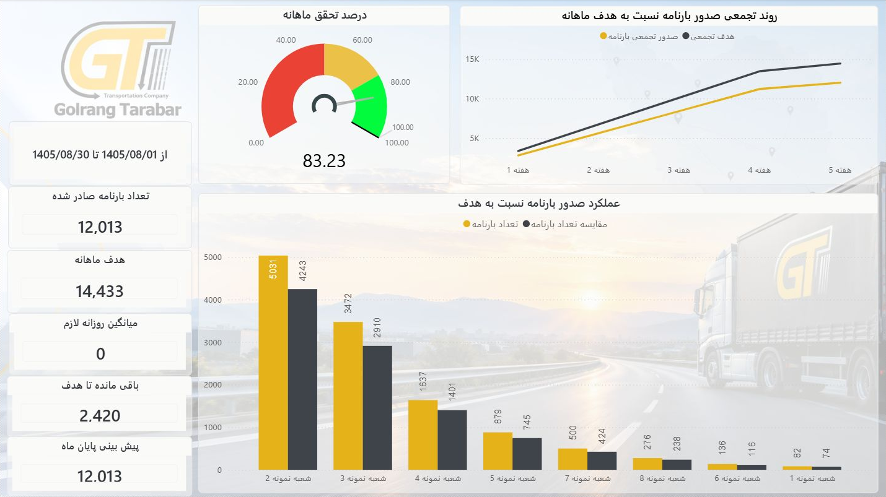

# داشبورد عملیات باربری | Waybill Operations Dashboard

این نمونه‌کار نسخهٔ هشت‌صفحه‌ای گزارش Power BI عملیات باربری را با **۲۶۳٬۸۱۱ بارنامهٔ کاملاً ساختگی** نشان می‌دهد. مدل نمونه‌کار به پایگاه دادهٔ سازمان متصل نیست.

- [پیش‌نمایش هشت صفحهٔ گزارش](https://anaram.github.io/waybill-operations-dashboard/)
- [فایل کامل Power BI](Waybill-Portfolio-Synthetic.pbix)

پیش‌نمایش وب تصاویر صفحه‌های خود گزارش را نشان می‌دهد. برای کار با تقویم، فیلترها، نقشه‌ها و جزئیات، فایل PBIX را در **Power BI Desktop for Report Server (May 2026)** باز کنید. در صفحه‌های «عملکرد کلی» و «تحلیل جغرافیایی»، آبان ۱۴۰۵ با مهر ۱۴۰۵ مقایسه شده است.

## English

The website previews the eight pages of the original Power BI design using screenshots from the synthetic-data report. Download the PBIX to use its filters, charts and maps in Power BI Desktop. All operational data in the portfolio model is synthetic.
